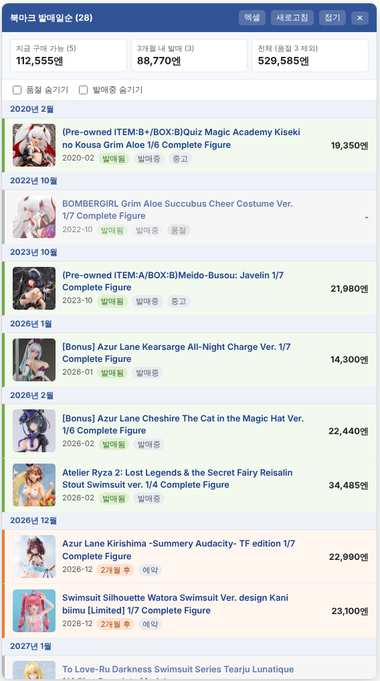

# 📅 지름 캘린더 for AmiAmi

AmiAmi 북마크(위시리스트)를 **발매일순**으로 정리해서 보여주는 크롬 확장 프로그램입니다.
"곧 사야 하는 거"가 한눈에 보이고, 사진이 들어간 **엑셀로 내보내기**도 됩니다.

## 업데이트 변경사항

| 작업 표기 | 변경 내용 |
|---|---|
| 20261118_002 | 상단 합계 카드 클릭으로 해당 상품만 표시. 다시 클릭하거나 **전체 보기**로 필터 해제 |
| 20261118_001 | 관세청 환율 기반 면세 한도, 상품별 과세 예상·예상 세액, 국제배송비 입력 및 엑셀 반영 |

## 기능

- 위시리스트 페이지에 들어가면 **모든 페이지를 자동으로 모아** 발매일순으로 정리
- 월별 묶음, 상품 사진, 상품 페이지 링크
- 합계 표시: 지금 구매 가능 / 3개월 내 발매 / 전체(품절 제외)
- 합계 카드를 클릭하면 해당 상품만 표시. 같은 카드를 다시 클릭하거나 **전체 보기**를 누르면 필터 해제
- 색 구분: 🟩 발매됨 · 🟧 3개월 내 발매 · ⬜ 품절
- 품절 숨기기 / 발매중 숨기기, 접기
- **엑셀 버튼**: 이미지 포함 .xlsx 다운로드 (색 구분·합계·링크 포함)
- 관세청 과세환율로 일본발 150달러 면세 한도를 엔화로 환산해 상품별 과세 여부 표시
- 상품당 국제배송비(엔)를 입력하면 관세 8%·부가세 10% 기준 예상 세액 표시 및 엑셀 내보내기

## 설치 방법

1. 이 페이지 위쪽 초록색 **`<> Code` → `Download ZIP`** 클릭
2. 받은 zip **압축 풀기**
3. 크롬 주소창에 `chrome://extensions` 입력
4. 오른쪽 위 **개발자 모드** 켜기
5. **압축해제된 확장 프로그램을 로드합니다** 클릭 → 압축 푼 폴더 선택
   - ⚠️ "매니페스트 파일이 없습니다"가 뜨면 한 단계 안쪽 폴더(`manifest.json`이 바로 보이는 폴더)를 선택하세요
6. AmiAmi 로그인 후 [위시리스트](https://www.amiami.com/eng/wishlist/) 접속 → 오른쪽에 패널이 뜹니다

> 업데이트: 새 버전 zip을 받아 같은 폴더에 덮어쓴 뒤 `chrome://extensions`에서 🔄(새로고침) 버튼을 누르면 됩니다.

## 참고 / 주의

- AmiAmi **영문 사이트**(`www.amiami.com/eng/`) 기준으로 동작합니다.
- 위시리스트는 브라우저 안에서 처리하며 개발자 서버로 전송하지 않습니다. 이미지와 공개 과세환율은 각 제공 사이트에서 읽습니다. 자세한 내용은 [개인정보 처리 안내](PRIVACY.md)를 참고하세요.
- AmiAmi 페이지 구조가 바뀌면 동작하지 않을 수 있습니다.
- 면세 판정은 각 상품을 따로 배송받는 경우를 가정합니다. 합배송, 통관 시점의 환율·품목분류에 따라 실제 세금이 달라질 수 있습니다. 관세청 조회가 실패하면 과세 여부를 표시하지 않습니다.
- AmiAmi 공식 프로그램이 아닌 개인 제작 비공식 도구입니다.

## 권한 설명

| 권한 | 용도 |
|---|---|
| `www.amiami.com` | 위시리스트 페이지에 정리 패널 표시 |
| `img.amiami.com` | 엑셀에 넣을 상품 이미지 받기 |
| `www.customs.go.kr` | 면세 한도 계산용 과세환율 읽기 |
| `scripting` | 엑셀 버튼을 누를 때만 엑셀 라이브러리 불러오기 |

## 라이선스

- 이 프로젝트: MIT
- 포함 라이브러리: [ExcelJS](https://github.com/exceljs/exceljs) (MIT, `exceljs.LICENSE`)
